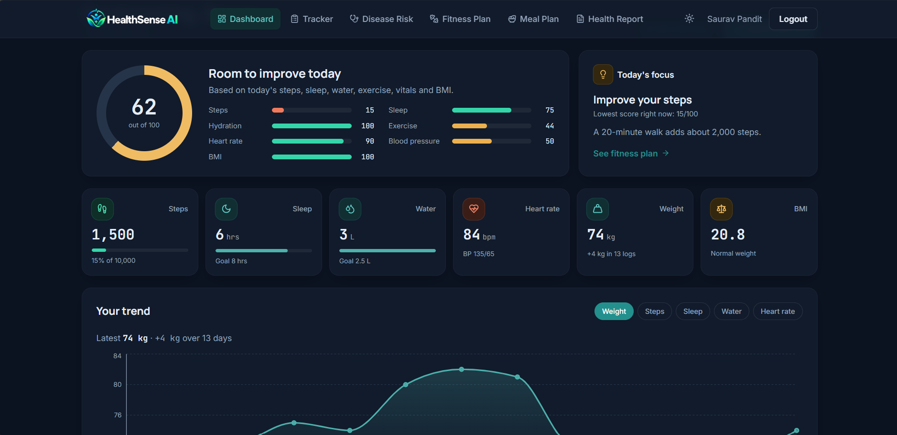
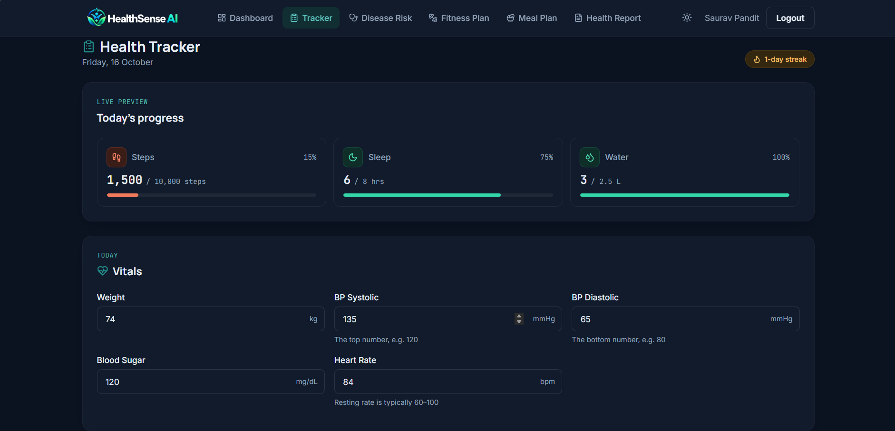
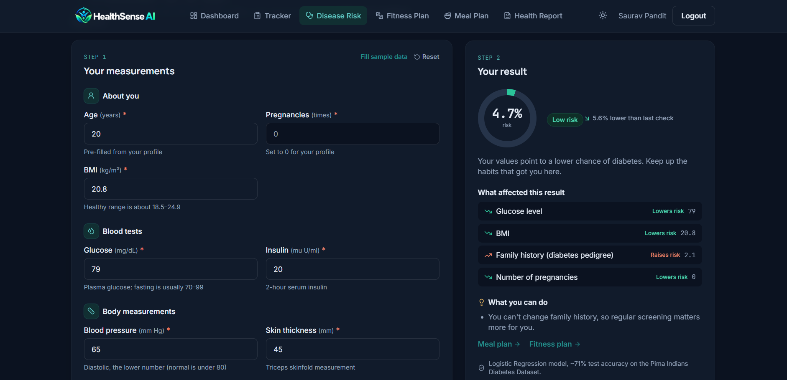
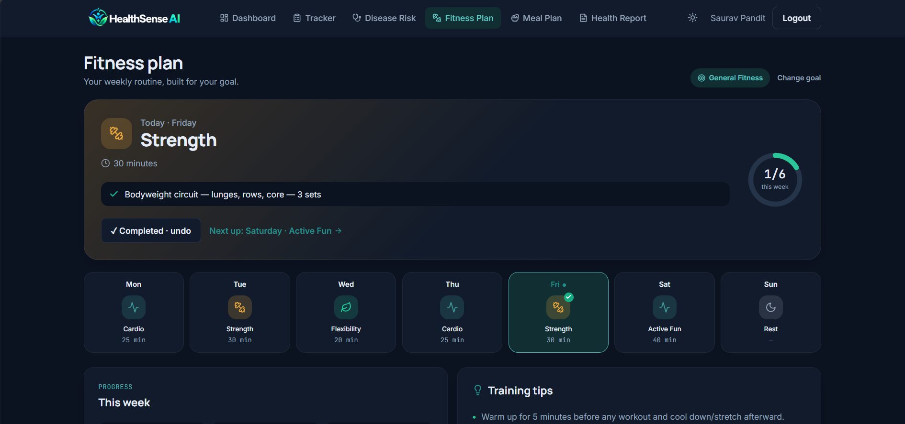
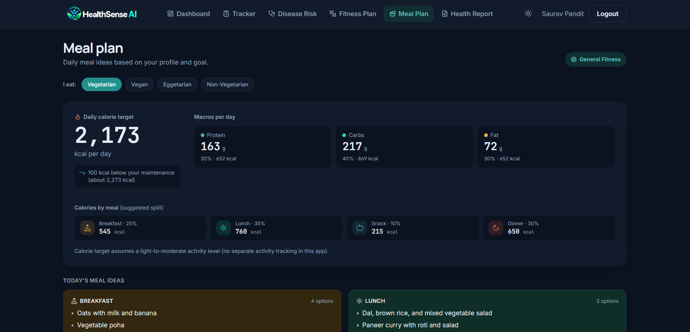
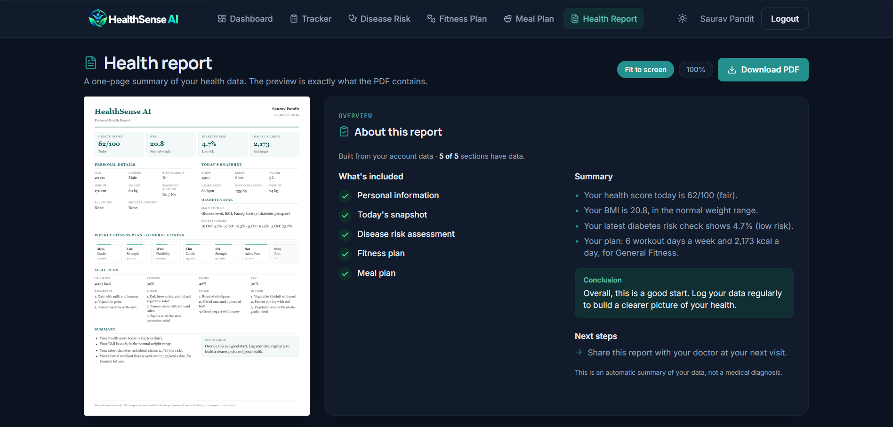

<div align="center">

# HealthSense AI

**AI-powered health tracker, diabetes risk prediction and smart wellness planner**

Track your daily vitals, get an explainable ML-based diabetes risk check, and receive personalized fitness and meal plans, all in one dashboard.

[**Live Demo**](https://health-sense-ai-x.vercel.app) · [**GitHub**](https://github.com/Saurav-Pandit2005/HealthSense-AI)


</div>

> **This is an educational project, not a medical device.** The risk model is trained on a public research dataset (not real clinical data), and every prediction is labeled as an estimate, not a diagnosis. Always consult a qualified healthcare professional for medical concerns.

---

## Features

| Module | What it does |
|---|---|
| **Landing page** | Public home page with product overview, feature highlights and sign-up links |
| **Authentication** | Register and log in with JWT and bcrypt. Strong password rule (8+ characters with an uppercase letter, a lowercase letter and a number) and a full **forgot / reset password** flow by email |
| **Health profile** | Age, gender, height, weight, blood group, allergies, medical history, lifestyle and fitness goal |
| **Health tracker** | Daily log of weight, blood pressure, blood sugar, heart rate, sleep, water, steps, exercise and calories |
| **Dashboard** | Daily greeting, a weighted 0-100 Health Score with a factor breakdown, a "Today's focus" tip for the weakest factor, progress tiles for steps, sleep and water, a switchable 14-day trend chart and quick links |
| **Disease risk** | Diabetes risk from a Logistic Regression model. Grouped form with validation and auto-fill, a result with the factors that raised or lowered *your* risk, practical tips, and a history timeline you can expand, reuse or delete |
| **Fitness planner** | Rule-based weekly plan by goal and age. Day-by-day view, "Mark as done" tracking and weekly progress |
| **Meal planner** | Daily calorie target with macros in grams, a suggested calorie split per meal, meal ideas for vegetarian, vegan, eggetarian and non-vegetarian diets, filtered against your allergies |
| **Health report** | A one-page A4 report (profile, snapshot, risk, fitness and meal plan) with an on-screen preview, an auto-generated summary and conclusion, and one-click PDF download |
| **Dark and light mode** | Theme toggle on every page. It follows the system theme by default, remembers your choice and has no flash on load |

## Screenshots

<table>
<tr>
<td></td>
<td></td>
</tr>
<tr>
<td></td>
<td></td>
</tr>
<tr>
<td></td>
<td></td>
</tr>
</table>

## The ML model

The disease risk module is trained on the **Pima Indians Diabetes Dataset** (768 patient records, 8 clinical features), not synthetic data.

- **Algorithm:** Logistic Regression, chosen over a black-box ensemble because its coefficients are directly interpretable. The app needs to explain *why* a risk was predicted, not just output a number.
- **Preprocessing:** several columns use `0` as a placeholder for "not recorded" (for example a blood pressure of 0 is impossible). These are detected and replaced with the column median before training.
- **Result:** **70.8% accuracy and 0.813 ROC-AUC** on a held-out 20% test set.
- **Feature importance** (standardized coefficient size): Glucose > BMI > Pregnancies > Family history (pedigree) > Age, which matches established clinical understanding of diabetes risk.
- **Per-prediction explainability:** each result shows *this user's* top contributing factors (coefficient x their standardized value). A low glucose reading correctly shows as risk-reducing, even though glucose's overall coefficient is positive.
- **Profile-aware report:** the "Number of pregnancies" factor is left out of the health report for male profiles.

## Tech stack

| Layer | Technology |
|---|---|
| Frontend | React 18, Vite, Tailwind CSS 3.4, React Router 6, Recharts, Axios, lucide-react, html2canvas + jsPDF |
| Backend | Node.js, Express, JWT, bcrypt, Mongoose, Nodemailer |
| Database | MongoDB Atlas |
| ML service | Python, FastAPI, scikit-learn, pandas |
| Hosting | Frontend on Vercel |

### Why two backends?

The Node/Express backend handles auth, CRUD and business logic. The FastAPI service exists only to serve the trained ML model. The frontend never talks to FastAPI directly: every request goes through the Node backend, which proxies the ML call. This keeps one service per concern, and the model can be retrained and redeployed independently.

## Project structure

```
HealthSense-AI/
├── backend/                       Node.js + Express API
│   ├── models/                    User, HealthLog, DiseaseRiskResult (Mongoose)
│   ├── controllers/               auth, profile, tracker, dashboard, risk, fitness, meal
│   ├── routes/                    Route definitions per module
│   ├── middleware/                JWT auth middleware
│   ├── utils/                     calculateBMI, calculateHealthScore, passwordPolicy,
│   │                              sendEmail, fitnessPlanGenerator, mealPlanGenerator
│   └── server.js
│
├── ml-service/                    FastAPI ML microservice
│   ├── app/
│   │   ├── main.py                API routes, model loading
│   │   ├── schemas.py             Pydantic request/response models
│   │   ├── data/diabetes.csv      Pima Indians Diabetes Dataset
│   │   └── model/                 Trained model artifact (.joblib)
│   └── train_model.py             Reproducible training script
│
└── frontend/                      React + Vite + Tailwind
    ├── public/                    logo.png, logo_mode.png, favicon.png
    └── src/
        ├── api/client.js          Axios instance, auto-attaches the JWT
        ├── context/               AuthContext, ThemeContext (dark / light mode)
        ├── components/            Navbar, Logo, ThemeToggle, PasswordInput, PasswordChecklist,
        │   └── ui/                ProtectedRoute, shared design system (Field, Card, States)
        ├── utils/passwordRules.js
        └── pages/                 Landing, Login, Register, ForgotPassword, ResetPassword,
                                   ProfileSetup, Dashboard, Tracker, DiseaseRisk,
                                   FitnessPlanner, MealPlanner, HealthReport
```

## Getting started

### Prerequisites
- Node.js 18+
- Python 3.10+
- A MongoDB Atlas connection string (the free tier is enough)

```bash
git clone https://github.com/Saurav-Pandit2005/HealthSense-AI.git
cd HealthSense-AI
```

### 1. Backend (Node/Express)

```bash
cd backend
npm install
cp .env.example .env     # then fill in the values below
npm run dev
```
Runs on `http://localhost:5000`.

Main `.env` values (see `.env.example` for the full list):

```dotenv
MONGO_URI=your_mongodb_atlas_uri
JWT_SECRET=a_long_random_string
ML_SERVICE_URL=http://localhost:8000
CLIENT_URL=http://localhost:5173

# Email for "Forgot password" (optional while developing)
SMTP_HOST=smtp.gmail.com
SMTP_PORT=587
SMTP_USER=your_email@gmail.com
SMTP_PASS=your_16_char_app_password
EMAIL_FROM=HealthSense AI <your_email@gmail.com>
```

> **Forgot password in development:** if the `SMTP_*` values are empty, the reset link is printed in the backend terminal instead of being emailed, so you can test the flow without setting up email. For Gmail, turn on 2-Step Verification and create an [App Password](https://myaccount.google.com/apppasswords) (your normal password will not work). `CLIENT_URL` is used to build the reset link, so set it to your real frontend URL in production.

### 2. ML service (FastAPI)

```bash
cd ml-service
python -m venv .venv
source .venv/bin/activate      # Windows: .venv\Scripts\activate
pip install -r requirements.txt
python train_model.py          # trains and saves the model (only needed once)
python -m uvicorn app.main:app --reload --port 8000
```
Runs on `http://localhost:8000`.

> On Windows, if `uvicorn` isn't recognized as a direct command, run it as `python -m uvicorn ...` as shown above.

### 3. Frontend (React)

```bash
cd frontend
npm install
npm run dev
```
Runs on `http://localhost:5173` and proxies `/api/*` to the backend.

**All three services need to be running** for the full app. The frontend needs the Node backend, and the Node backend needs the FastAPI service for the Disease Risk module only (every other module works without it).

## Pages

| Route | Page | Access |
|---|---|---|
| `/` | Landing page | Public |
| `/login`, `/register` | Sign in / create account | Public |
| `/forgot-password`, `/reset-password/:token` | Password reset | Public |
| `/profile-setup` | Health profile | Logged in |
| `/dashboard` | Dashboard | Logged in + profile complete |
| `/tracker` | Daily health log | Logged in + profile complete |
| `/disease-risk` | Diabetes risk check and history | Logged in + profile complete |
| `/fitness-planner` | Weekly workout plan | Logged in + profile complete |
| `/meal-planner` | Calorie target and meal plan | Logged in + profile complete |
| `/health-report` | Report preview and PDF download | Logged in + profile complete |

## API overview

| Method | Endpoint | Description |
|---|---|---|
| `POST` | `/api/auth/register`, `/api/auth/login` | Auth |
| `POST` | `/api/auth/forgot-password` | Email a password reset link |
| `POST` | `/api/auth/reset-password/:token` | Set a new password with a reset token |
| `GET` | `/api/auth/me` | Current session user |
| `GET` / `PUT` | `/api/profile` | Health profile |
| `POST` / `GET` | `/api/tracker`, `/api/tracker/today`, `/api/tracker/history` | Daily health logs |
| `GET` | `/api/dashboard/summary` | BMI, health score, today's snapshot |
| `POST` / `GET` | `/api/risk/diabetes`, `/api/risk/history` | Disease risk prediction and history |
| `DELETE` | `/api/risk/:id` | Delete one of your past assessments |
| `GET` | `/api/fitness/plan` | Weekly workout plan |
| `GET` | `/api/meal/plan?preference=` | Daily meal plan |

All routes except register, login, forgot-password and reset-password require an `Authorization: Bearer <token>` header.

## Design decisions worth knowing

- **Health Score** is a transparent weighted formula (steps, sleep, hydration, exercise, heart rate, blood pressure, BMI), not a black box. If a user hasn't logged every field, the score rescales to what is available instead of penalizing missing data.
- **One tracker entry per day** (unique `user` + `date` index). Later edits to the same day update the existing entry, which keeps the trend chart clean.
- **Password safety:** passwords are hashed with bcrypt. Reset tokens are random, stored only as a SHA-256 hash, expire after 30 minutes and are deleted once used. The forgot-password endpoint gives the same response whether or not an email is registered, so it can't be used to discover accounts. The strong-password rule applies to sign-up and reset; log-in does not enforce it so older accounts still work.
- **Meal allergy filtering** uses a synonym map (for example an "egg" allergy also matches "omelette"), because dish names don't always contain the allergen's name.
- **Theming** uses CSS variables with Tailwind's `class` dark mode, so every colour token switches at once. Charts read their colours from the same theme.
- **Health report / PDF:** the report is a fixed A4-width page built with explicit inline styles (not Tailwind classes), and fonts are awaited before capture. Both were needed for reliable `html2canvas` output. The on-screen preview is scaled separately, so the PDF is always full size.
- **Workout "done" status** is stored in the browser (`localStorage`, one entry per week), so it is per device.

## Future scope

- Additional disease risk models (heart disease, hypertension) using the same explainable-model approach
- Admin panel for user and record management
- Saving workout progress and meal choices to the account instead of the browser
- Wearable device integration for automatic tracker data

## Author

Built by **Saurav Pandit**. [GitHub](https://github.com/Saurav-Pandit2005)

## License

MIT. Built as an academic project, free to learn from and build on.

---

<div align="center">
<sub>Educational purposes only. Not a substitute for professional medical advice.</sub>
</div>
